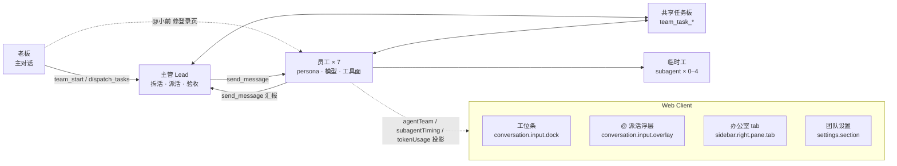

<div align="center">


# 员工办公室 · dsh-work-team

**把 DSH 主对话变成老板办公室：拆活、派活、验收，员工在侧边栏里实时上班。**

[](https://github.com/deepseek-ai/deepseek-harness)
[](#开发)
[](#开发)
[](LICENSE)

</div>

---

你对着主对话说「把设置页的保存按钮改成乐观更新」。主管把这句话拆成任务，派给前端，前端做完回报，审查卡一道质量门——这些角色不是临时工，而是常驻的、有名字有性格的员工。右侧边栏里，你能一眼看到谁在想、谁在干、谁卡住、谁交付了。

这个仓库是一个 **DSH profile bundle**，同时包含 Host 插件与 Web Client 插件。它不重新发明多智能体：成员名单、共享任务板、互发消息、持久化与重启恢复都来自官方的 `@deepseek-ai/dsh-experimental-agent-team`。本包补的是产品层——角色人格、一人一模型、办公室界面、派活通道、编制与自动化开关。

## 亮点

- **八个内置角色，七席默认阵容**：阿策（产品）、小前（前端）、老后（后端）、小审（审查/测试）、小研（研究）、小设（设计）、老运（运维）常驻，第八席留给笔笔（文案）。每个角色有独立 persona、职责边界、汇报节奏和工具面。
- **一人一模型**：`provider::model[::effort]` 精确指定；留空则动态跟随主对话，主对话换模型时员工跟着换。
- **办公室就在侧边栏**：右侧边栏的 `office` tab，顶部统计 + `办公室 / 任务板` 段控 + 44px 单列工位行。按侧边栏宽度做容器查询自适应，窄到 340px 只留头像环和状态点。
- **三条派活通道**：输入框上方的工位条、`@角色` 浮层、以及不带 `@` 的普通消息（交给主管拆解）。工位条和浮层都把任务直接写进员工会话，主对话只留一句回执。
- **工具面收窄**：每位员工只带本职工具，一次请求的 tools schema 从 101 个 / 79KB 降到 20–34 个，平均省 73%。
- **编制与开关都可调**：团队上限 8 人、自动组建三档、员工能否自主招人、每人能开几个临时工、主管是否亲手改文件——全部在 DSH 设置里改，多数开关下一次调用即生效。
- **复用官方底座**：共享任务板、员工互发消息、成员持久化、重启恢复都由 Agent Teams 提供，本包只在其上做产品层。

## 快速开始

### 前置

- 已安装 DSH，且 `dsh` 在 `PATH` 里（`dsh --help` 能跑通）。
- Node.js ≥ 20。
- 一个 Web profile（下面以 `web` 为例）。
- **Agent Teams bundle**：`@deepseek-ai/dsh-experimental-agent-team-profile`。这是实验包，默认模板里没有：

```bash
dsh plugin --profile web add @deepseek-ai/dsh-experimental-agent-team-profile
```

### 安装

```bash
git clone https://github.com/keeptrue/dsh-work-team.git
cd dsh-work-team

# Host 代码 import 的两个包随 DSH 安装提供，不随仓库分发：
# 把它们软链进本目录的 node_modules
node scripts/link-host-deps.mjs

# 作为本地 bundle 装进 profile（同时写进 package.json 的 dsh.profile.bundles）
dsh plugin --profile web add link:"$PWD"

# 重启 Web 端
dsh web
```

`link-host-deps.mjs` 会从 `dsh` 二进制反推安装目录，把 `@deepseek-ai/schemastery` 与 `@deepseek-ai/dsh-tools` 链到 `node_modules/@deepseek-ai/`；重复执行是幂等的。装到别处时也可以 `node scripts/link-host-deps.mjs --host /path/to/dsh-install`。

### 验证

新开一个主对话，说「**组建团队**」。主管调用 `team_start`，七位员工逐个入职；输入框上方出现工位条，侧边栏「员工办公室」tab 里能看到每个人的状态。再问一句「现在团队在干什么」，主管用 `team_status` 汇总给你。

## 怎么用

### 组建团队

| 说法 | 发生什么 |
|---|---|
| 「组建团队」/「把团队补满」 | 主管调用 `team_start`，按默认阵容补齐到编制数，已存在的角色跳过 |
| 「招文案」 | 先把编制调到 8，再让主管 `hire_teammate` 招 `writer` |
| 「研究员换成 GLM-5.3」 | 在 DSH 设置 → 团队设置里改对应模型字段，或让主管处理 |

`team_start` 只招内置角色；`spawn_teammate` 建的是临时协作者，不是正式员工。员工自己也能招人：缺角色时直接招（受编制上限），编制满时自动降级成一张「招聘申请」任务，由你拍板。

### 派活：三种方式

1. **`@` 浮层**：输入框敲 `@`，继续打出能命中角色的字（`@小`、`@阿策`、`@backend`），候选浮层才弹出。已入职的排前面，未入职的灰显并标「未入职」。`↑` / `↓` 选项，`Enter` 进入任务输入行，写完再 `Enter`。
2. **直接打 `@` 前缀**：不理浮层，直接敲 `@小前 把登录页的按钮对齐修一下` 回车。消息直接进小前的会话，主对话只留一句派单回执。
3. **普通消息**：不带 `@` 的走主管——它判断该谁做，简单任务直接交代，复杂任务先建共享任务再让员工认领。

裸 `@`、`@src/`、`@README` 这类没命中角色的输入不归本插件管，照旧交给官方的文件 / 会话菜单。

### 办公室面板

- **入口**：点工位条的标题、会话标题栏的办公室按钮，或侧边栏「+」引导页里的「员工办公室」。
- **顶部统计**：`7/8 人 · 干活中 N · 等你回复 N · 团队已用 X`。
- **段控**：`办公室 | 任务板(N)`。任务板按 `待办 / 进行中 / 已完成 / 被阻塞` 分组，显示负责人、依赖与涉及文件。
- **状态八种**：入职中、已就位、待命、干活中、等你回复、有新结果、异常结束、入职失败。
- **工位条**：输入框上方常驻；悬停出名片（名字 / 角色 / 当前任务），点头像进会话，名片里的 `↗` 直接派活。触屏没有 hover，第一次点开名片、第二次进会话。

### 团队设置

在 **DSH 设置 → 团队设置**（排在「模型」之后、「插件」之前）。每位员工的模型、汇报频率和自动化开关都在这里，改动即时生效。

## 内置角色

| 团队名 | 中文名 | 角色 | 工具面 |
|---|---|---|---|
| `pm` | 阿策 | 产品经理 / 拆需求 | 核心 + 搜索 / 抓取 / 读图 |
| `frontend` | 小前 | 前端工程师 | 核心 + 浏览器 + 读图 + UI 渲染校验 |
| `backend` | 老后 | 后端工程师 | 核心 + 终端 + 后台作业 |
| `reviewer` | 小审 | 审查 / 测试 | 只读：无 `write` / `edit` |
| `researcher` | 小研 | 研究员 | 只读 + 搜索 / 会话检索 |
| `designer` | 小设 | 设计师 | 核心 + 浏览器 + 生图 + UI 渲染校验 |
| `ops` | 老运 | 运维 / 脚本 | 核心 + 终端 + 后台作业 + 定时任务 |
| `writer` | 笔笔 | 文案 / 写作 | 核心 + 搜索 / 抓取 + 生图（默认阵容之外，需手动招） |

别名可用：`product` → `pm`、`fe` → `frontend`、`qa` → `reviewer`、`devops` → `ops`、`copy` → `writer`。

## 配置

配置写在 profile 的 `work-team` 行，设置面板会通过 DSH Settings 持久化到 `cordis.patch.yml`。

| 字段 | 默认 | 说明 |
|---|---|---|
| `teamSize` | `7` | 团队编制，1–8 |
| `reporting` | `milestones` | 汇报频率：`milestones` 关键节点 / `completion` 只在完成时 / `every-step` 每一步 |
| `allowSelfHire` | `true` | 员工能否直接招人。逐次求值：关掉后工具仍在，调用被拒并说明原因；编制满时直招自动转成招聘申请 |
| `maxWorkersPerEmployee` | `2` | 每位员工同时能开的临时工（一次性 subagent）上限，0–4；`0` = 禁止 |
| `trimEmployeeTools` | `true` | 按角色裁剪工具面。关掉后员工恢复宿主提供的全部工具 |
| `employeeStepBudget` | `24` | 员工「收敛预算」：约多少次工具调用内交付的软提示（0–60），80% 时先报卡点；`0` = 省略 |
| `autoStart` | `off` | 自动组建：`off` / `first-message`（收到第一条消息后开始）/ `immediate`（新会话即开始） |
| `dispatchPrefix` | `true` | 主对话里以 `@角色` 开头的消息由 Host 兜底转发给该员工；逐条消息读 |
| `leadHandsOff` | `false` | 主管不亲手改文件：`write` / `edit` 被拒并给出理由，`read` / `grep` / `bash` 照常 |
| `modelPm` | 空 | 阿策的模型 |
| `modelFrontend` | 空 | 小前的模型 |
| `modelBackend` | 空 | 老后的模型 |
| `modelReviewer` | 空 | 小审的模型 |
| `modelResearcher` | 空 | 小研的模型 |
| `modelDesigner` | 空 | 小设的模型 |
| `modelOps` | 空 | 老运的模型 |
| `modelWriter` | 空 | 笔笔的模型 |

模型值格式 `provider::model`，例如 `workbuddy-cn::deepseek-v4.1-flash`，也支持 `provider::model::effort`。空字符串表示跟随主对话：应用时刻钉住当时那条 route，之后主对话换模型会由 `model/selection` 事件重新钉一次。

**生效时机**：`dispatchPrefix` 逐条消息读；`leadHandsOff`、`allowSelfHire`、`maxWorkersPerEmployee` 每次调用求值；`trimEmployeeTools` 在设置保存后重新应用一次；`autoStart` 只在主管会话创建或恢复时判定一次；`teamSize` 在下一次招人时按新编制算。

## 架构



**Host（`index.js` + `lib/`）**

- Lead scope：老板指南、`team_start` / `hire_teammate` / `dispatch_tasks` / `team_status`、编制守卫、可选的 `write` / `edit` 逐次拦截。
- Employee scope：每次请求重拼的 persona、角色工具白名单、`request_hire` / `hire_teammate`、临时工上限守卫。
- `agent/pre-step`（主管会话）：`@` 兜底转发与首条消息触发自动组建。
- 自动组建：后台两路并发补齐编制，带幂等锁，中途关档会在当前这位完成后停下。
- 模型同步：`agent/created`、插件重载、主对话 `model/selection` 变化三处触发。

**Client（`client.js`）**

- 注册 `sidebar.right.pane.tab`（办公室，页面型 tab）、`conversation.input.dock`（工位条）、`conversation.input.overlay`（`@` 浮层）、`conversation.session.header.actions`（办公室按钮）、`settings.section`（团队设置）。
- 不新增 session event 类型：团队状态来自 `agentTeam` 投影，模型来自 `modelSelection`，耗时来自 `subagentTiming`，token 来自 `tokenUsage`。
- `@` 派活走 `sessions.retain` + `binding.session.prompt(..., 'queue')` 直接写进员工会话，不经过主对话消息流。
- Q 版 SVG 头像 + CSS 状态动画，尊重 `prefers-reduced-motion`。

## 项目结构

```text
dsh-work-team/
├─ index.js              Host 插件：工具、persona、模型同步、编制守卫、自动组建、@ 转发
├─ client.js             Web Client：工位条、办公室、任务板、设置、@ 浮层、头像动画
├─ lib/
│  ├─ roles.js           八个角色定义、默认阵容、别名、角色工具清单
│  ├─ toolset.js         工具白名单分组与按角色的 allow 集
│  ├─ personas.js        老板指南、员工 persona、入职话术
│  ├─ models.js          模型字符串解析、token / 时长格式化
│  ├─ autostart.js       自动组建状态机、补员计划、hands-off 规则
│  └─ dispatch.js        @ 角色解析、派单回执、失败降级文案
├─ locale/               插件显示元数据（zh / en）
├─ scripts/
│  ├─ link-host-deps.mjs 把 DSH 自带的依赖链进本目录
│  └─ measure-context.mjs 请求体积度量（system 字符数 / tools 字节数）
├─ test/                 191 项单测（node --test）
├─ docs/                 UI 规格与设计文档
├─ cordis.patch.yml      bundle 行与默认配置
└─ icon.svg
```

## 开发

```bash
npm test          # node --test test/  —— 191 项，全绿
npm run measure   # 量一次会话请求体积：system 字符数、tools 字节数、注入次数
```

测试分五层：`roles.test.js` 与 `toolset.test.js` 测纯函数和工具白名单；`host.test.js` 测宿主接线（自动组建 / `@` 转发 / 工具收口 / 临时工上限 / 满编降级）；`model-apply.test.js` 测员工模型应用（Agent 级选择、失败重试、幂等、主对话换模型后重钉）；`client-roles.test.js`、`dock-fan.test.js`、`member-status.test.js`、`office-v5.test.js` 测客户端状态机与布局约束。

改 `lib/roles.js` 的角色时记得同步 `client.js` 顶部的镜像 `ROLES` 表——两侧都按 id 取名字、配色和状态。

## 设计取舍

- **不做第十个多智能体框架**。roster、任务板、消息、持久化都在 Agent Teams 里，重复实现只会让两边状态打架。本包只做角色、模型和界面。
- **工具裁剪是省 token，不是沙箱**。它只决定员工看得见哪些工具；真正的权限边界是 DSH 的 permission preset / sandbox。`bash` 依然能写文件。
- **状态来自回合结算，不是未读位**。平台把「非主会话的 running 结束」都记一次未读，入职那一回合也算——这正是「只说一句开启团队、七个人全显示有新结果」的来源。所以这里用 `subagentTiming.settledMs` 的单调累计值做阈值判定。
- **`@` 直派绕过主管**。员工收到的是你打的那句原文：没有拆解、没有验收标准、没有分工。简单明确的活这样最快；复杂任务先不带 `@` 说需求。

## 已知限制

- **成员名单只增不减**。Agent Teams 把成员写进会话日志，设计上没有删除 / 改名 / 名字复用；要缩编就开新会话。
- **员工工具白名单是精确名单**。宿主新增工具不会自动进来，工具改名后新名字不在名单里。探测不到时退化为部分裁剪或完全不裁剪，不会把员工裁到不能用。
- **临时工上限按 step 计**。`subagent` 声明了并发安全，同一个 step 里并发发出的委派会在任何子会话出现前一起通过守卫，所以「上限 2」实际是「每 step 最多 2 个」；真正的全局天花板是 subagent 服务的 `maxActiveSubagents`。
- **模型切换只写 Agent 级选择**。走 `selectForNextRequest`，不动主对话模型和 profile 默认值；代价是校验自己做，且入职那一回合仍跑旧路由，下一次请求才生效。
- **状态最多延迟 2 秒**。客户端仅在页面可见时每 2 秒批量读一次投影；页面隐藏时不轮询，切回来立刻补读。
- **自动组建默认关，因为花 token**。每位员工入职都要跑一次 turn。
- **Agent Teams 是实验包**。本插件依赖它的 `tryMembership`、`spawnTeammate` 和 `agentTeam` 投影，DSH 升级后需要回归。

## 版本

| 版本 | 主要内容 |
|---|---|
| 2.2 | 按角色裁剪工具面（一次请求平均 −73%） |
| 2.1 | 员工临时工（每人 0–4 个）；员工自主招人，满编自动降级成招聘申请 |
| 2.0 | 办公室搬进右侧边栏；八种状态可视化；交接动画与容器查询布局 |
| 1.5 | 自动组建三档；`@` 派活浮层与 Host 兜底转发；工具面收口 |

## 许可

[MIT](LICENSE)
