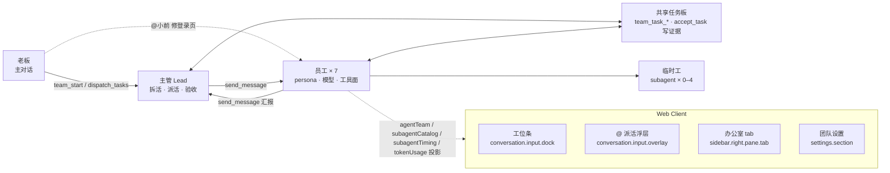

<div align="center">


# 员工办公室 · dsh-work-team

**把 DSH 主对话变成老板办公室：拆活、派活、验收，员工在侧边栏里实时上班。**

[](https://github.com/deepseek-ai/deepseek-harness)
[](#开发)
[](#开发)
[](LICENSE)

</div>

---

你对着主对话说「把设置页的保存按钮改成乐观更新」。主管把这句话拆成任务，派给前端，前端做完回报，审查卡一道质量门——这些角色不是临时工，而是常驻的、有名字有性格的员工。右侧边栏里，你能一眼看到谁在想、谁在干、谁卡住、谁交付了。

这个仓库是一个 **DSH profile bundle**，同时包含 Host 插件与 Web Client 插件。它不重新发明多智能体：成员名单、共享任务板、互发消息、持久化与重启恢复都来自官方的 Agent Teams 底座（0.2.1 的 `@deepseek-ai/dsh-experimental-agent-team`，0.2.2 起由 `@deepseek-ai/dsh-base` 自带）。本包补的是产品层——角色人格、一人一模型、办公室界面、派活通道、编制与自动化开关。

## 亮点

- **八个内置角色，七席默认阵容**：阿策（产品）、小前（前端）、老后（后端）、小审（审查/测试）、小研（研究）、小设（设计）、老运（运维）常驻，第八席留给笔笔（文案）。每个角色有独立 persona、职责边界、汇报节奏和工具面。
- **一人一模型**：`provider::model[::effort]` 精确指定；留空则动态跟随主对话，主对话换模型时员工跟着换。
- **办公室就在侧边栏**：右侧边栏的 `office` tab，顶部统计 + `办公室 / 任务板` 段控 + 44px 单列工位行。按侧边栏宽度做容器查询自适应，窄到 340px 只留头像环和状态点。
- **三条派活通道**：输入框上方的工位条、`@角色` 浮层、以及不带 `@` 的普通消息（交给主管拆解）。工位条和浮层都把任务直接写进员工会话，主对话只留一句回执。
- **工具面收窄**：每位员工只带本职工具，一次请求的 tools schema 从 101 个 / 79KB 降到 20–34 个，平均省 73%。
- **编制与开关都可调**：团队上限 8 人、自动组建三档、员工能否自主招人、每人能开几个临时工、主管是否亲手改文件——全部在 DSH 设置里改，多数开关下一次调用即生效。
- **验收门**：`accept_task(taskId, evidence)` 是关闭任务的唯一通道。证据空白或全是空格直接拒收，任务一个字段都不动；证据为非空字符串时写进任务描述，再把任务置 completed，同一段证据只写一次。派单时给某一行加 `review: true`，Host 自动建一条审查任务指派给审查员。
- **团队预算**：`teamTokenBudget` 一个上限盖住主管会话与全体员工，`tokenBudgetOnExceed` 选 `warn`（照常干，标出超支）或 `block`（拦住派活与招人，不拦验收）。派活、招人、验收的回执与 `team_status` 都带 `budget{used,limit,mode,exceeded,unknown,note}`。用量按已加载的会话统计，读不到的成员计入 `unknown`，`used` 是下界（见[已知限制](#已知限制)）。
- **体检**：`team_status.health` 回答三件事——这次挂的是哪条团队拓扑（`subagent-tree` / `team-service` / `unsupported`，附原因）、谁的配置模型没应用上、谁的工具面被裁得比声明少。健康时 `trimmedTools` 是空数组。
- **停职**：`benchRoles` 填角色 id 把某个角色挂起。占编制、不接新活、仍可被验收，不是删除也不是故障。所有派活入口都拒，话术一致；文书与验收照常走。
- **换届**：`team_handover` 生成一份数据简报并写到工作目录下的 `.dsh/work-team/handover.md`，带来真实花名册、在办任务、待验收队列、被阻塞任务、诊断与预算。名单与任务板不随新会话迁移，简报开头就写明这一点。旧会话还加载着时，`team_recover` 能把它的旧板只读地读出来，照着重建。
- **员工权限档**：`presetReviewer` / `presetResearcher` / `presetOps` 给这三个角色切权限档。插件只切换、不定义：名字不在这台机器的名单里就不生效，并报出可用名单。
- **复用官方底座**：共享任务板、员工互发消息、成员持久化、重启恢复都由 Agent Teams 提供，本包只在其上做产品层。

## 快速开始

### 前置

- 已安装 DSH，且 `dsh` 在 `PATH` 里（`dsh --help` 能跑通）。
- Node.js ≥ 20。
- 一个 Web profile（下面以 `web` 为例）。
- **Agent Teams 底座**：两种拓扑都支持，插件按能力探测选路，不读版本号。DSH 0.2.2 起 `@deepseek-ai/dsh-base` 自带 agent-team 服务（`maxTasks` 在 `dsh-base` 自己的 `cordis.patch.yml` 里配到 256），不需要再装包；DSH 0.2.1 仍需实验包 `@deepseek-ai/dsh-experimental-agent-team-profile`，默认模板里没有：

```bash
# 仅 DSH 0.2.1 需要
dsh plugin --profile web add @deepseek-ai/dsh-experimental-agent-team-profile
```

两条拓扑差在哪、各自少什么，见 [docs/dual-topology.md](docs/dual-topology.md)。

### 安装

```bash
git clone https://github.com/keeptrue/dsh-work-team.git
cd dsh-work-team

# Host 代码 import 的两个包随 DSH 安装提供，不随仓库分发：
# 把它们软链进本目录的 node_modules
node scripts/link-host-deps.mjs

# 作为本地 bundle 装进 profile（同时写进 package.json 的 dsh.profile.bundles）
dsh plugin --profile web add link:"$PWD"

# 重启 Web 端
dsh web
```

`link-host-deps.mjs` 会从 `dsh` 二进制反推安装目录，把 `@deepseek-ai/schemastery` 与 `@deepseek-ai/dsh-tools` 链到 `node_modules/@deepseek-ai/`；重复执行是幂等的。装到别处时也可以 `node scripts/link-host-deps.mjs --host /path/to/dsh-install`。

### 验证

新开一个主对话，说「**组建团队**」。主管调用 `team_start`，七位员工逐个入职；输入框上方出现工位条，侧边栏「员工办公室」tab 里能看到每个人的状态。再问一句「现在团队在干什么」，主管用 `team_status` 汇总给你。

## 怎么用

### 组建团队

| 说法 | 发生什么 |
|---|---|
| 「组建团队」/「把团队补满」 | 主管调用 `team_start`，按默认阵容补齐到编制数，已存在的角色跳过 |
| 「招文案」 | 先把编制调到 8，再让主管 `hire_teammate` 招 `writer` |
| 「研究员换成 GLM-5.3」 | 在 DSH 设置 → 团队设置里改对应模型字段，或让主管处理 |

`team_start` 只招内置角色；`spawn_teammate` 建的是临时协作者，不是正式员工。员工自己也能招人：缺角色时直接招（受编制上限），编制满时自动降级成一张「招聘申请」任务，由你拍板。

### 派活：三种方式

1. **`@` 浮层**：输入框敲 `@`，继续打出能命中角色的字（`@小`、`@阿策`、`@backend`），候选浮层才弹出。已入职的排前面，未入职的灰显并标「未入职」。`↑` / `↓` 选项，`Enter` 进入任务输入行，写完再 `Enter`。
2. **直接打 `@` 前缀**：不理浮层，直接敲 `@小前 把登录页的按钮对齐修一下` 回车。消息直接进小前的会话，主对话只留一句派单回执。
3. **普通消息**：不带 `@` 的走主管——它判断该谁做，简单任务直接交代，复杂任务先建共享任务再让员工认领。

裸 `@`、`@src/`、`@README` 这类没命中角色的输入不归本插件管，照旧交给官方的文件 / 会话菜单。

### 验收与审查

`dispatch_tasks` 的每一行可以带三个可选字段：`acceptance`（验收标准）、`review`（要不要建审查任务）、`taskId`（这行实现的哪条共享任务）。只有 `review: true` 才建任务：

- 任务板可用时，Host 建一条 `审查：<任务前 60 字>` 的审查任务并指派给 `reviewer`；给了 `taskId` 就以它为前置依赖，审查要等实现任务完成才轮到。`acceptance` 抄进审查任务描述，让审查按同一把尺子判。
- 任务板关着或打不开时，同一条请求降级成发给审查员的一条消息，该行回执里 `review.degraded` 是 `true`、`created` 是 `false`；派单本身仍算发出。

员工回报「做完了」之后，用 `accept_task(taskId, evidence)` 关任务：

| 情况 | 结果 |
|---|---|
| 证据空白或全是空格 | 拒收，任务零改动（revision 也不变） |
| 证据非空 | 证据追加进任务描述（`验收证据：` 分隔），任务置 `completed` |
| 同一段证据再验收一次 | 不重复写入，回执说明已记录 |
| 还有前置任务没完成 | 拒收，列出没完成的 id，任务零改动 |
| 任务板关着 / 打不开 | 拒收并说明该开哪个开关 |
| 任务还是 `pending`（没人认领） | 拒收，先认领或先 `reassign` |

`team_status.pendingAcceptance` 就是验收队列：负责人是员工、状态是进行中、且不是审查任务的那些活。老板指南里也写死了三条硬规矩：没证据不验收、完工必走 `accept_task`、改代码必须让审查员看 diff。

### 停职、换届与权限档

**停职**：`benchRoles` 填角色 id，逗号、顿号、分号或空白分隔。写角色 id 或短别名（`fe` / `qa` / `ops`）最稳；中文显示名在这里无效。停职的员工还在名册上、还占着自己的编制位，只是不再接新活——不是删除，也不是故障。

停职挡的是**模型发起的新派活**：`hire_teammate`、`dispatch_tasks` 的每一行、`@角色` 兜底转发、`send_message`（含员工互发）、`request_hire` 都会拒，话术一致，都告诉你先复职；`team_start` 与后台自动组建则跳过停职席位不招，回执里点名跳过了谁。停职**不挡文书与验收**：审查任务降级、给审查员发审查请求、以及 `accept_task` 的验收，停职期间照常走。

`team_status` 用 `benchedRoles` 与 `members[].benched` 回报停职状态；`benchRoles` 里认不出的 token 会进 `health.note`，不会静默失效。

**换届**：成员只增不减，换班的正路是开一个新会话。`team_handover({ note? })` 返回 `{ markdown, path, written }`，把简报写到 `.dsh/work-team/handover.md`。

- 简报里全是数据：花名册、在办任务、待验收队列、被阻塞任务、诊断、预算。没有「最近决策」之类的总结——插件没有这个来源，缺的地方写「（无）」。
- **名单与任务板不随新会话迁移**。任务板是从 root 会话日志重建的，新会话是新 root、空日志，`team_status` 会报 `size 0 / tasks 0`，这是正常的。
- 想延续在办工作只有两条路：先在旧会话收尾（该验收的验收掉）再换届，或在新会话按简报用 `team_task_create` 重建任务再让员工认领。旧 task id 跨会话不可用，拿旧 id 调 `accept_task` 只会回找不到。
- 每次调用都重生成并覆盖同一个文件，手写补充会被冲掉。
- 拿不到工作区路径或写盘失败时不报错：返回 `written: false`、`path: ''`，`markdown` 顶部写明原因，简报照样能直接贴给新会话。

办公室顶部的「换届」按钮只给主对话发一句请求，让主管去跑 `team_handover`，不自己拼简报。

**旧板还能不能读**：`team_recover({ sessionId, limit? })` 只读地读**旧 root 会话**的任务板，前提是那个会话还被 Host 加载着。返回 `{ found, sessionId, enabled, tasks, total, truncated, members, membersSource, note }`：`found: false` 表示旧会话已卸载，只能按简报重建；`limit` 默认 200、上限 500，被截断时 `truncated` 为 `true` 且 `total` 仍是全量。花名册哪条投影有数据就用哪条（0.2.1 的 `agentTeam.members` 或 0.2.2 的 `subagentCatalog`），都没有就是空数组并在 `note` 里说明。全程零写入：不建任务、不改任务、不碰团队开关；旧 task id 在新会话里也不能拿来验收。

**权限档**：`presetReviewer` / `presetResearcher` / `presetOps` 分别对应审查员、研究员、运维，空 = 不接管。插件只切换、不定义权限档：名字要在这台机器上已经定义过（默认部署通常只有 `workspace-write` / `danger-full-access`，要只读档得先在 profile 里定义），否则不生效并在 `health.presetNote` 里报出可用名单；权限档服务不可用也不阻断入职；已是该档时再保存不会重写；永不作用于主对话。填的是配置，实际生效值看 `team_status.members[].preset`。

别给审查配只读档：只读沙箱会挡住 `npm test` 的临时文件，测试会以权限错的形式失败，看起来像代码问题。

### 办公室面板

- **入口**：点工位条的标题、会话标题栏的办公室按钮，或侧边栏「+」引导页里的「员工办公室」。
- **顶部统计**：`7/8 人 · 干活中 N · 等你回复 N · 团队已用 X / Y`。没设上限时读 `团队已用 X（未设上限）`；超限时多一个「超预算」chip；有人停职时末尾多一项 `N 停职`。用量把主对话自己也算进去。
- **顶部按钮**：`换届` 把当前团队写成一份给新会话的简报（见上一节）。
- **段控**：`办公室 | 任务板(N)`。任务板按 `待办 / 进行中 / 已完成 / 被阻塞` 分组，显示负责人、依赖与涉及文件；等主管验收的任务卡上带「待验收」徽标。
- **任务板可操作，但只发请求**：lead 视角的任务卡多「指派」「验收」两个按钮，建任务走表单（标题必填、≤200 字，描述与涉及文件可选）。三个动作都只是往主对话发一句请求，由主管用 `team_task_create` / `team_task_update` / `accept_task` 执行；提交后只回一句「已交给主管建任务 / 改派 / 验收」，不会假装板上已经变了。员工会话里没有这些写入口。
- **员工详情抽屉**：点工位或办公室行上的详情按钮打开，只读——名字与角色、实际生效的模型、token、在办任务、最近活动、最近事件（这条桥没有员工事件流，如实写「无」），以及一键打开会话。`Esc` 关闭，焦点回到打开它的按钮。
- **状态九种**：入职中、已就位、待命、干活中、等你回复、有新结果、异常结束、入职失败、停职（0.2.2 下看不到前两者，其余照常，见[已知限制](#已知限制)）。停职的员工仍在工位上，灰环，与「未入职空位」视觉可分；故障优先于停职显示，两个标记可以同时挂着。
- **工位条**：输入框上方常驻；悬停出名片（名字 / 角色 / 当前任务），点头像进会话，名片里的 `↗` 直接派活。触屏没有 hover，第一次点开名片、第二次进会话。

### 团队设置

在 **DSH 设置 → 团队设置**（排在「模型」之后、「插件」之前）。每位员工的模型、汇报频率、自动化开关、停职名单、三个权限档和团队 token 预算都在这里，改动即时生效。

## 内置角色

| 团队名 | 中文名 | 角色 | 工具面 |
|---|---|---|---|
| `pm` | 阿策 | 产品经理 / 拆需求 | 核心 + 搜索 / 抓取 / 读图 |
| `frontend` | 小前 | 前端工程师 | 核心 + 浏览器 + 读图 + UI 渲染校验 |
| `backend` | 老后 | 后端工程师 | 核心 + 终端 + 后台作业 |
| `reviewer` | 小审 | 审查 / 测试 | 只读：无 `write` / `edit` |
| `researcher` | 小研 | 研究员 | 只读 + 搜索 / 会话检索 |
| `designer` | 小设 | 设计师 | 核心 + 浏览器 + 生图 + UI 渲染校验 |
| `ops` | 老运 | 运维 / 脚本 | 核心 + 终端 + 后台作业 + 定时任务 |
| `writer` | 笔笔 | 文案 / 写作 | 核心 + 搜索 / 抓取 + 生图（默认阵容之外，需手动招） |

别名可用：`product` → `pm`、`fe` → `frontend`、`qa` → `reviewer`、`devops` → `ops`、`copy` → `writer`。

## 配置

配置写在 profile 的 `work-team` 行，设置面板会通过 DSH Settings 持久化到 `cordis.patch.yml`。

| 字段 | 默认 | 说明 |
|---|---|---|
| `teamSize` | `7` | 团队编制，1–8 |
| `reporting` | `milestones` | 汇报频率：`milestones` 关键节点 / `completion` 只在完成时 / `every-step` 每一步 |
| `allowSelfHire` | `true` | 员工能否直接招人。逐次求值：关掉后工具仍在，调用被拒并说明原因；编制满时直招自动转成招聘申请 |
| `maxWorkersPerEmployee` | `2` | 每位员工同时能开的临时工（一次性 subagent）上限，0–4；`0` = 禁止 |
| `trimEmployeeTools` | `true` | 按角色裁剪工具面。关掉后员工恢复宿主提供的全部工具 |
| `employeeStepBudget` | `24` | 员工「收敛预算」：约多少次工具调用内交付的软提示（0–60），80% 时先报卡点；`0` = 省略 |
| `teamTokenBudget` | `0` | 团队累计 token 上限，覆盖主管会话与全体员工；`0` = 不限。读不到用量的成员计入 `unknown`，此时 `used` 是下界 |
| `tokenBudgetOnExceed` | `warn` | 超上限怎么办：`warn` 照常干，只在回执与办公室顶部标出；`block` 拦住 `dispatch_tasks` 与 `hire_teammate`，验收不受影响。只有精确的 `block` 生效，其它值一律按 `warn` |
| `benchRoles` | 空 | 停职角色：角色 id，逗号、顿号、分号或空白分隔；认短别名（`fe` / `qa` / `ops`），不认中文显示名。空 = 无人停职 |
| `presetReviewer` | 空 | 审查员的权限档名；空 = 不接管。名字必须已在这台机器上定义，插件只切换、不创建 |
| `presetResearcher` | 空 | 研究员的权限档名；规则同上 |
| `presetOps` | 空 | 运维的权限档名；规则同上 |
| `autoStart` | `off` | 自动组建：`off` / `first-message`（收到第一条消息后开始）/ `immediate`（新会话即开始） |
| `dispatchPrefix` | `true` | 主对话里以 `@角色` 开头的消息由 Host 兜底转发给该员工；逐条消息读 |
| `leadHandsOff` | `false` | 主管不亲手改文件：`write` / `edit` 被拒并给出理由，`read` / `grep` / `bash` 照常 |
| `modelPm` | 空 | 阿策的模型 |
| `modelFrontend` | 空 | 小前的模型 |
| `modelBackend` | 空 | 老后的模型 |
| `modelReviewer` | 空 | 小审的模型 |
| `modelResearcher` | 空 | 小研的模型 |
| `modelDesigner` | 空 | 小设的模型 |
| `modelOps` | 空 | 老运的模型 |
| `modelWriter` | 空 | 笔笔的模型 |

模型值格式 `provider::model`，例如 `workbuddy-cn::deepseek-v4.1-flash`，也支持 `provider::model::effort`。空字符串表示跟随主对话：应用时刻钉住当时那条 route，之后主对话换模型会由 `model/selection` 事件重新钉一次。

**生效时机**：`dispatchPrefix` 逐条消息读；`leadHandsOff`、`allowSelfHire`、`maxWorkersPerEmployee`、`teamTokenBudget`、`tokenBudgetOnExceed`、`benchRoles` 每次调用求值（预算在派活、招人、验收时现读现算，停职在派活、招人、转发、发消息时现读现判）；`presetReviewer` / `presetResearcher` / `presetOps` 在入职装好之后与每次设置保存后各应用一次；`trimEmployeeTools` 在设置保存后重新应用一次；`autoStart` 只在主管会话创建或恢复时判定一次；`teamSize` 在下一次招人时按新编制算。

## 架构



**Host（`index.js` + `lib/`）**

- Lead scope：老板指南、`team_start` / `hire_teammate` / `dispatch_tasks` / `team_status` / `accept_task` / `team_handover` / `team_recover`、编制守卫、可选的 `write` / `edit` 逐次拦截。
- `dispatch_tasks` 每行新增 `acceptance` / `review` / `taskId`：`review` 走 `lib/acceptance.js` 造审查任务，板不可用时改发消息并在回执里标 `degraded`。
- 验收门：`accept_task` 用 compare-and-set 分两次写（`edit` 证据、`complete` 状态），空证据、未完成的前置、关着的板都在碰任务之前就拒。
- 体检与预算：`team_status` 带 `pendingAcceptance`、`health{topology,note,modelErrors,trimmedTools}`、`budget`；`lib/budget.js` 每次都现算 `used`（主管会话 + 每位员工的会话级用量），`block` 只拦花钱的两条路径。
- 停职：`benchRoles` 经 `lib/bench.js` 解析（别名归一到角色 id），逐次判定；`team_start` 与自动组建跳过停职席位，`hire_teammate` / `dispatch_tasks` / `@` 转发 / `request_hire` 直接拒，`send_message` 在 Lead 与员工两个 scope 各挂一道守卫；`accept_task` 与审查任务不查停职。
- 权限档：`presetReviewer` / `presetResearcher` / `presetOps` 在员工装好之后与每次设置保存后各切换一次；只切换、不定义，服务缺失或名字不存在都不阻断入职。
- `team_recover` 只读：直接读 `ctx.sessions.get(sessionId)` 那条会话的投影，刻意不调 `ensureBoard`（它会追加 `team/mode` 事件），也不建任务、不改任务。员工 scope 上不注册这个工具。
- Employee scope：每次请求重拼的 persona、角色工具白名单、`request_hire` / `hire_teammate`、临时工上限守卫。
- `agent/pre-step`（主管会话）：`@` 兜底转发与首条消息触发自动组建。
- 自动组建：后台两路并发补齐编制，带幂等锁，中途关档会在当前这位完成后停下。
- 模型同步：`agent/created`、插件重载、主对话 `model/selection` 变化三处触发。

**Client（`client.js`）**

- 注册 `sidebar.right.pane.tab`（办公室，页面型 tab）、`conversation.input.dock`（工位条）、`conversation.input.overlay`（`@` 浮层）、`conversation.session.header.actions`（办公室按钮）、`settings.section`（团队设置）。
- 不新增 session event 类型：任务板与团队状态来自 `agentTeam` 投影，员工花名册来自 `subagentCatalog` 投影（0.2.2；0.2.1 走 `agentTeam.members`），模型来自 `modelSelection`，耗时来自 `subagentTiming`，token 来自 `tokenUsage`。
- `@` 派活走 `sessions.retain` + `binding.session.prompt(..., 'queue')` 直接写进员工会话，不经过主对话消息流。
- 任务板上的写操作在客户端只做到「拼一句请求发进主对话」：浏览器侧的 Agent Teams 只有 `setEnabled` 一个写通道，`createTask` / `updateTask` 的 caller 必须是活着的 Agent，所以建任务、指派、验收都交给 Lead 执行，面板不乐观改本地状态。
- 员工详情抽屉是纯读：事实来自 `agentTeam` / `subagentCatalog` / `tokenUsage` / `subagentTiming` 投影；没有员工事件流，所以「最近事件」固定写「无」。
- Q 版 SVG 头像 + CSS 状态动画，尊重 `prefers-reduced-motion`。

## 项目结构

```text
dsh-work-team/
├─ index.js              Host 插件：工具、persona、模型同步、编制守卫、自动组建、@ 转发
├─ client.js             Web Client：工位条、办公室、任务板、设置、@ 浮层、头像动画
├─ lib/
│  ├─ roles.js           八个角色定义、默认阵容、别名、角色工具清单
│  ├─ toolset.js         工具白名单分组与按角色的 allow 集
│  ├─ personas.js        老板指南、员工 persona、入职话术
│  ├─ models.js          模型字符串解析、token / 时长格式化
│  ├─ autostart.js       自动组建状态机、补员计划、hands-off 规则
│  ├─ dispatch.js        @ 角色解析、派单回执、失败降级文案
│  ├─ acceptance.js      验收门文本：审查任务主语与描述、证据追加、幂等判定
│  ├─ bench.js           停职规则：benchRoles 解析（含别名）、统一拒绝话术
│  ├─ budget.js          团队 token 预算：归一化、快照、超限拦单话术
│  ├─ handover.js        换届简报：纯渲染，数据全部来自 Host 报告
│  └─ team-bridge.js     两条团队拓扑的桥：成员解析、消息投递、任务板开关
├─ locale/               插件显示元数据（zh / en）
├─ scripts/
│  ├─ link-host-deps.mjs 把 DSH 自带的依赖链进本目录
│  ├─ measure-context.mjs 请求体积度量（system 字符数 / tools 字节数，带 `--check` 阈值）
│  └─ run-tests.mjs      测试入口：按三种测试文件命名枚举 test/ 下的所有测试（fixture 不入选）
├─ .github/workflows/    test.yml：node 20 / 22 矩阵跑单测与体积守卫
├─ test/                 339 项单测（`npm test`）；v2.3 加 acceptance-gate / budget / client-roster，v2.4 加 bench / handover / presets，v2.5 加 recover，fixture 在 support/gate-host.js
├─ docs/                 UI 规格与设计文档
├─ cordis.patch.yml      bundle 行与默认配置
└─ icon.svg
```

## 开发

CI：[](https://github.com/keeptrue/dsh-work-team/actions/workflows/test.yml) — GitHub Actions 按 node 20 / 22 跑 `npm test`，再跑体积守卫。runner 除了枚举，还会拒绝「导入了 `node:test` 却不匹配任何测试文件名模式」的文件，并设了文件数下限，防止新文件静默不跑。仓库没有 lockfile，工作流现装 `@deepseek-ai/dsh-tools@0.2.2-rc.2` 与 `@deepseek-ai/schemastery@3.19.0`，DSH 升级时要跟着抬。

```bash
npm test          # scripts/run-tests.mjs —— 按三种命名枚举测试文件交给 node --test，全绿
npm run measure   # 量一次会话请求体积：system 字符数、tools 字节数、注入次数
node scripts/measure-context.mjs --check 60000 100000   # 超阈值时非零退出（CI 守卫）
```

测试文件由 `scripts/run-tests.mjs` 自己枚举：`node --test test/` 在 node 22 上会把目录当模块路径直接报错，所以不传目录。

体积预算沿用 2026-11-13 的实测：system 47,221 字符（阈值 60,000）、tools 87,084 字节（阈值 100,000）。CI 里没有会话日志，这一步打印 SKIP 并 exit 0——**skip 不等于体积被验证过**，绿色的 CI 只说明那台机器量不了。

测试覆盖：`roles.test.js` 与 `toolset.test.js` 测纯函数和工具白名单；`host.test.js` 测宿主接线（自动组建 / `@` 转发 / 工具收口 / 临时工上限 / 满编降级）；`model-apply.test.js` 测员工模型应用（Agent 级选择、失败重试、幂等、主对话换模型后重钉）；`acceptance-gate.test.js` 测验收门与审查任务（空证据不改任务、证据幂等、前置未完成拒收、板关闭降级、体检拓扑），`budget.test.js` 测预算归一化与三条花钱路径的拦法，`bench.test.js` 测停职在七个入口的拒绝与「仍可被验收」、`handover.test.js` 测简报渲染与空板事实、`presets.test.js` 测权限档的幂等与不生效路径、`recover.test.js` 测 `team_recover` 的只读与两种拓扑回落（fixture 在 `test/support/gate-host.js`）；`client-roles.test.js`、`client-roster.test.js`、`dock-fan.test.js`、`member-status.test.js`、`office-v5.test.js` 测客户端状态机、花名册推导、任务请求拼装与布局约束。

改 `lib/roles.js` 的角色时记得同步 `client.js` 顶部的镜像 `ROLES` 表——两侧都按 id 取名字、配色和状态。

## 设计取舍

- **不做第十个多智能体框架**。roster、任务板、消息、持久化都在 Agent Teams 里，重复实现只会让两边状态打架。本包只做角色、模型和界面。
- **工具裁剪是省 token，不是沙箱**。它只决定员工看得见哪些工具；真正的权限边界是 DSH 的 permission preset / sandbox。`bash` 依然能写文件。
- **状态来自回合结算，不是未读位**。平台把「非主会话的 running 结束」都记一次未读，入职那一回合也算——这正是「只说一句开启团队、七个人全显示有新结果」的来源。所以这里用 `subagentTiming.settledMs` 的单调累计值做阈值判定。
- **`@` 直派绕过主管**。员工收到的是你打的那句原文：没有拆解、没有验收标准、没有分工。简单明确的活这样最快；复杂任务先不带 `@` 说需求。

## 已知限制

- **别用「审查：」当普通任务标题**。验收门用它自己写进 `writeScopes` 的 `work-team/review/` 标记认出审查任务；旧版建的任务没有这个标记，于是退化成看主语前缀，所以**任何**以「审查：」开头的任务都会被当成审查任务，不进 `pendingAcceptance`——哪怕负责人是后端。想给任务起这种名字，换个前缀。
- **任务视图没有时间字段**。`pendingAcceptance[].ageMs` 在真板子上恒为 0：Team 服务给的 `TeamTaskView` 只有 id / revision / 主语 / 描述 / 状态 / 依赖 / writeScopes / 负责人，没有创建时间。字段说明写的就是「无法获得时为 0」，所以别把 0 读成「刚创建」，文档也不承诺一条活等了多久。只有组合恰好暴露 `createdAt` 时它才是真数字——宁可报 0，也不凭空估一个等待时长。
- **`accept_task` 是两次写，不是事务**。内核的 `complete` 只改状态、忽略一切文本字段，所以验收先 `edit` 写证据、再 `complete` 改状态。第一步成功、第二步失败时证据已经在任务上，回执会明说，再调一次即可补上——不会重复写证据。
- **`used` 是下界，`block` 也可能放过已超支的团队**。用量只统计**已加载的会话**（`ctx.sessions.get`）：会话已卸载的成员（例如进程重启后还没被重新激活的员工）不计入 `used`，只计入 `unknown`，`budget.note` 里写明人数与原因（会话没加载 / 用量投影读不到）。所以 `used` 是「读得到的部分」，不是账单；`unknown > 0` 时真实用量可能更高，`block` 档也可能让一个实际已经超支的团队继续派活。组合没有 `ctx.sessions` 时只能读活着的 Agent，没在跑的员工一律计入 `unknown`。
- **任务板开关读不到时不自动打开**。读 `agentTeam` 投影失败会被当成「情况不明」而不是「没选过」：不会替你打开任务板，也就不会覆盖你在模型选项里亲手关掉的选择。此时 `team_status.taskBoard` 报 `unavailable`，顶层 `note` 给出下一步（重试一次，或去会话面板打开 Agent Teams）；开关读取失败的具体原因记进 Host 日志，不在回执里。
- **换届后新板是空的**。名单与任务板都不随新会话迁移：任务板从 root 会话日志重建，新会话是新 root、空日志，`team_status` 报 `size 0 / tasks 0` 是正常结果。旧 task id 跨会话不可用，`accept_task` 只会回找不到；要延续在办工作，只能在旧会话收尾后再换届，或在新会话用 `team_task_create` 重建再认领。
- **`benchRoles` 不认中文显示名**。它走角色 id 与短别名，写「小审」会被当成无法识别的 token 进 `health.note`，停职不生效；而 `send_message` 的停职守卫用的是更宽的解析器，中文名在那边反而认。写角色 id 或短别名最稳。
- **权限档填了不等于生效**。插件只切换、不定义：名字不在这台机器上就不生效，`health.presetNote` 会说明并给出可用名单；实际生效值看 `team_status.members[].preset`。
- **`.dsh/work-team/handover.md` 每次覆盖**。`team_handover` 每次调用都重生成整份文件，手写补充会被冲掉；要留历史就自己另存。
- **客户端没有写板通道**。浏览器侧的 Agent Teams 只暴露开关（`setEnabled`），`createTask` / `updateTask` 的 caller 必须是活着的 Agent。所以面板上的建任务、指派、验收都只是「把一句请求转给主管执行」，不是实时写入口；提交那一下板上没有变化，真实状态以任务板回读为准。
- **`team_recover` 只能读还加载着的旧会话**。旧 root 一旦从 Host 卸载（进程重启、会话被回收），`found` 就是 `false`，只能按 handover 简报用 `team_task_create` 重建。它只读，也不能跨会话验收或移动任务——旧 task id 在新会话里不存在。
- **成员名单只增不减**。Agent Teams 把成员写进会话日志，设计上没有删除 / 改名 / 名字复用；要缩编就开新会话。
- **员工工具白名单是精确名单**。宿主新增工具不会自动进来，工具改名后新名字不在名单里。探测不到时退化为部分裁剪或完全不裁剪，不会把员工裁到不能用。
- **临时工上限按 step 计**。`subagent` 声明了并发安全，同一个 step 里并发发出的委派会在任何子会话出现前一起通过守卫，所以「上限 2」实际是「每 step 最多 2 个」；真正的全局天花板是 subagent 服务的 `maxActiveSubagents`。
- **员工级模型需要内核提供 Agent 级选择接口**。插件走 `sessionController.agents.selectForNextRequest` 把模型钉到员工会话；没有这个接口的内核上，员工只能跟随主对话模型，`team_status` 的 `health.modelErrors` 会把这条写成「这个 DSH 内核没有 Agent 级模型选择注册表（sessionController exposes no selection registry）」并指出是哪个角色、哪个模型。
- **模型切换只写 Agent 级选择**。走 `selectForNextRequest`，不动主对话模型和 profile 默认值；代价是校验自己做，且入职那一回合仍跑旧路由，下一次请求才生效。
- **状态最多延迟 2 秒**。客户端仅在页面可见时每 2 秒批量读一次投影；页面隐藏时不轮询，切回来立刻补读。
- **自动组建默认关，因为花 token**。每位员工入职都要跑一次 turn。
- **任务板门禁是会话级的**（0.2.2）。agent-team 给团队协作加了会话开关，任务板关着时任何任务板操作都抛 `TEAM_DISABLED`。插件在首次用到团队工具（`team_start` / `team_status` / `hire_teammate` / `dispatch_tasks`）或自动组建时，替当前会话把任务板打开；但你在输入框的模型选项里显式关掉之后，它不再覆盖这个选择，此时 `team_status` 用 `taskBoard` 字段回报状态（`on` / `off` / `unavailable` / `unsupported`）。0.2.1 没有这个开关，这一层直接跳过。板被关掉或开不了时（`off` / `unavailable`）招聘申请改投主管收件箱：`request_hire` 和满编时的 `hire_teammate` 都走这条路，返回值里的 `delivered` 是 `task` 或 `message`，说明这次申请落在任务板还是消息通道。
- **0.2.2 的花名册来自 `subagentCatalog`**。0.2.2 的 `agentTeam` 投影不再带 `members`，员工名单改由 `subagentCatalog` 投影（`id` / `name` / `mode`）推导；0.2.1 仍读 `members`。历史 catalog 行没有 `name` 时，办公室和工位条上那一行只能显示空缺。
- **0.2.2 下看不到「入职中」「入职失败」两态**。花名册由 `subagentCatalog` 推导，可用状态就受 catalog 约束——catalog 只记录**已经存在**的子会话：入职那一回合在 catalog 里出现行之前没有东西可读，失败的子会话也不会留下行。其余状态（含停职，它来自配置而不是花名册）照常，按「办公室面板」那段列的九种减去这两个读。
- **团队底座有两个版本面**。0.2.1 的成员关系在 `ctx.agentTeams`（`tryMembership` / `spawnTeammate` / `members`），0.2.2 搬到 `ctx.subagents` 的具名子 agent 树；插件按能力探测（`tryMembership`，或 `rootOf` + `namesOf`），两条路都要回归。

## 版本

| 版本 | 主要内容 |
|---|---|
| 2.5 | `team_recover` 只读读取旧会话任务板；办公室任务板可建任务 / 指派 / 验收（转给主管执行）；员工详情抽屉；CI 与 `scripts/run-tests.mjs` |
| 2.4 | 停职（`benchRoles`）；换届（`team_handover`）；员工权限档（`presetReviewer` / `presetResearcher` / `presetOps`） |
| 2.3 | 验收门（`accept_task` + 派单 `review`）；团队 token 预算；`team_status.health` 体检 |
| 2.2.1 | 适配 0.2.2：团队工具与自动组建首次调用时开启会话任务板；花名册改由 `subagentCatalog` 推导 |
| 2.2 | 按角色裁剪工具面（一次请求平均 −73%） |
| 2.1 | 员工临时工（每人 0–4 个）；员工自主招人，满编自动降级成招聘申请 |
| 2.0 | 办公室搬进右侧边栏；八种状态可视化；交接动画与容器查询布局 |
| 1.5 | 自动组建三档；`@` 派活浮层与 Host 兜底转发；工具面收口 |

## 许可

[MIT](LICENSE)
